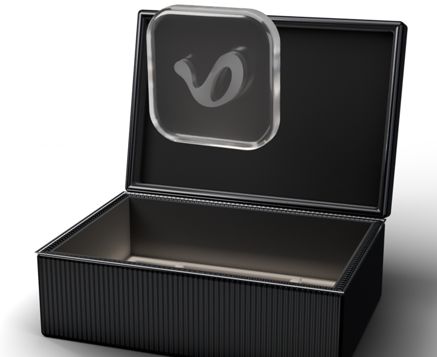

<div align="center">


# V0 Visualizer App

**Your Last.fm listening, as a profile you want to look at. Now in a window of its own.**

For Windows, macOS and Linux · Free

<br>

<a href="https://v0visualizer.com/download"></a>

<br>
<br>

[](https://github.com/V0-Visualizer/V0-Visualizer-App/releases/latest)
[](https://github.com/V0-Visualizer/V0-Visualizer-App/releases)
[](#install)

[Website](https://v0visualizer.com) &nbsp;·&nbsp; [What's new](https://github.com/V0-Visualizer/V0-Visualizer-App/releases) &nbsp;·&nbsp; [Support](https://v0visualizer.com/support) &nbsp;·&nbsp; [Privacy](https://v0visualizer.com/privacy)

<br>



</div>

## What it is

V0 Visualizer turns your [Last.fm](https://www.last.fm) history into a profile: your top artists, albums and tracks, how your taste moves over time, what you rediscover, and what the people you follow are playing. It works with anything that scrobbles to Last.fm, such as Spotify, Apple Music or YouTube Music.

The app is all of V0 in a window of its own, with what a browser tab cannot do.

## What the app adds

<table>
  <tr>
    <td align="center" width="33%"><br><b>Mini player</b><br><sub>A small window with the song you are playing. It can stay on top of everything else.</sub></td>
    <td align="center" width="33%"><br><b>V0Rooms in a window</b><br><sub>Listen together in a room that keeps playing in its own window, with or without the chat.</sub></td>
    <td align="center" width="33%"><br><b>Notifications</b><br><sub>Replies, Wall activity and rewards arrive like any other app's, with a count on the taskbar or Dock.</sub></td>
  </tr>
  <tr>
    <td align="center"><br><b>Discord status</b><br><sub>Shows what you are listening to on your Discord profile, when you turn it on.</sub></td>
    <td align="center"><br><b>Keyboard shortcuts</b><br><sub>Search, the mini player and the side panels, without reaching for the mouse.</sub></td>
    <td align="center"><br><b>Updates by itself</b><br><sub>New versions install in the background. Each one is checked before it installs.</sub></td>
  </tr>
</table>

It can also start with your computer and wait in the tray. You need a free [Last.fm](https://www.last.fm/join) account. The app reads your listening history; it does not scrobble for you and does not look at the files on your computer.

## Install

The easiest way is **[v0visualizer.com/download](https://v0visualizer.com/download)**: it picks the right file for your computer. Every file is also on the **[latest release](https://github.com/V0-Visualizer/V0-Visualizer-App/releases/latest)**.

<details open>
<summary><b>Windows 10 and 11</b></summary>
<br>

<a href="https://apps.microsoft.com/detail/9PMLZ8DF1M17"></a>

The simplest way on Windows: install it from the **[Microsoft Store](https://apps.microsoft.com/detail/9PMLZ8DF1M17)**, and the Store keeps it up to date.

Or use the installer:

1. Download and run **`V0-Visualizer-Setup-<version>.exe`**.
2. If Windows says *Windows protected your PC*, choose **More info**, then **Run anyway**. The installer is not code-signed yet; the app itself checks every update before it installs it. The Store version does not show this warning.
3. Sign in. The app opens your browser and comes back on its own.

Prefer a package manager? With [Scoop](https://scoop.sh):

```powershell
scoop bucket add v0 https://github.com/V0-Visualizer/V0-Visualizer-App
scoop install v0/v0-visualizer
```

winget is on the way.

</details>

<details>
<summary><b>macOS 11 or later (Apple silicon)</b></summary>
<br>

1. Download **`V0-Visualizer-<version>-macOS-arm64.dmg`** and drag **V0 Visualizer** into Applications.
2. The first time, **right-click the app and choose Open**: it is not notarized by Apple yet.
3. If macOS says the app is *damaged*, run this once and open it again:

```sh
xattr -dr com.apple.quarantine "/Applications/V0 Visualizer.app"
```

Or with [Homebrew](https://brew.sh):

```sh
brew tap v0-visualizer/app https://github.com/V0-Visualizer/V0-Visualizer-App
brew install --cask v0-visualizer
```

Intel Macs are not supported yet; V0 works in your browser there.

</details>

<details>
<summary><b>Linux (x86_64)</b></summary>
<br>

**AppImage**, which updates itself:

```sh
chmod +x V0-Visualizer-*-linux-x86_64.AppImage
./V0-Visualizer-*-linux-x86_64.AppImage
```

**Debian, Ubuntu and their relatives:**

```sh
sudo apt install ./V0-Visualizer-*-linux-amd64.deb
```

If the AppImage does not start on Ubuntu 24.04 or later, install `libfuse2t64` first. A blank window on some graphics drivers is fixed by starting it with `WEBKIT_DISABLE_DMABUF_RENDERER=1`.

</details>

<details>
<summary><b>Phones</b></summary>
<br>

Apps for Android and iPhone are coming. Until then, all of V0 works in your phone's browser at [v0visualizer.com](https://v0visualizer.com).

</details>

## Updates

The app checks for a new version in the background and installs it when you restart. It only installs an update whose signature matches the key it ships with. What changed in each version is on its [release page](https://github.com/V0-Visualizer/V0-Visualizer-App/releases).

## Help

| | |
|---|---|
| Questions, bugs, ideas | [v0visualizer.com/support](https://v0visualizer.com/support) |
| Talk to other listeners | [V0 on Discord](https://discord.gg/FpbNECYT5M) |
| A security problem | [SECURITY.md](SECURITY.md) |

<details>
<summary><b>About this repository</b></summary>
<br>

This repository is where the app is published: its releases, the update feed installed apps read, the Homebrew cask (`Casks/`) and the Scoop manifest (`bucket/`). They are updated automatically with every release; the `.sig`, `latest.json`, `latest.yml` and `.app.tar.gz` files on a release are for the updater, not for you to download. The app's source is not public.

V0 Visualizer is free to use under the [Terms of Use](https://v0visualizer.com/terms). It is not affiliated with Last.fm, Spotify or Discord.

</details>

---

<details>
<summary><b>Türkçe</b></summary>
<br>

**V0 Visualizer App**, Last.fm dinleme geçmişini bakmak isteyeceğin bir profile dönüştürür: en çok dinlediğin sanatçılar, albümler ve şarkılar, zevkinin zaman içinde nasıl değiştiği ve takip ettiklerinin ne dinlediği. Uygulama V0'ın tamamını kendi penceresinde açar; mini oynatıcı, kendi penceresinde V0Rooms, bildirimler, Discord durumu, klavye kısayolları ve kendiliğinden güncelleme ekler.

**İndir:** [v0visualizer.com/download](https://v0visualizer.com/download) bilgisayarına uygun dosyayı seçer. Tüm dosyalar [son sürümde](https://github.com/V0-Visualizer/V0-Visualizer-App/releases/latest).

- **Windows:** en kolayı [Microsoft Store](https://apps.microsoft.com/detail/9PMLZ8DF1M17). Yükleyiciyi kullanırsan ve SmartScreen "Windows bilgisayarınızı korudu" derse **Ek bilgi**, ardından **Yine de çalıştır**'ı seç.
- **macOS:** uygulamayı Applications'a sürükle, ilk açılışta sağ tıklayıp **Aç**'ı seç.
- **Linux:** AppImage'ı `chmod +x` ile çalıştırılabilir yap ya da `.deb`'i `sudo apt install` ile kur.
- **Telefon:** Android ve iPhone uygulamaları yolda; o zamana kadar V0 telefonunun tarayıcısında çalışır.

Ücretsiz bir Last.fm hesabı gerekir. Uygulama kendini günceller; her güncelleme kurulmadan önce doğrulanır. Destek: [v0visualizer.com/support](https://v0visualizer.com/support)

</details>
